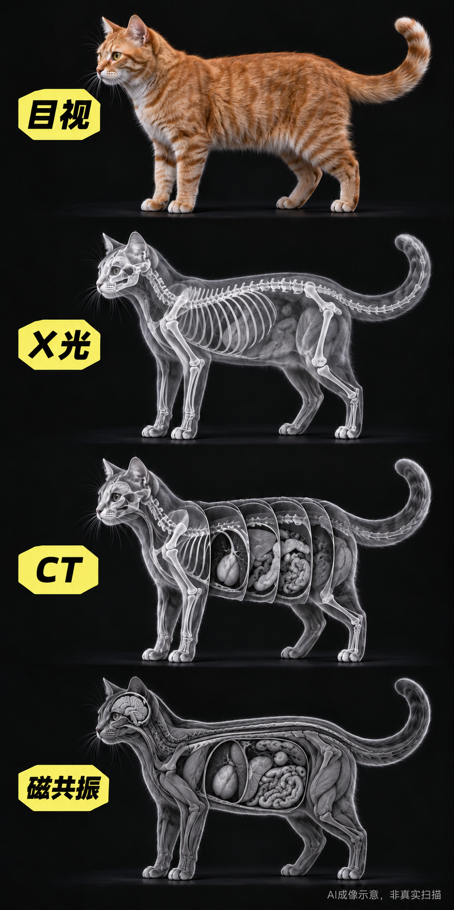

# 贴图号·动物X光扫描图文创作

`animal-scan-compare` 是一个面向 Codex 与 WorkBuddy 的动物扫描对比图文创作 Skill。它用于生成黑底写实、大动物主体、纵向四行的目视／X光／CT／磁共振对比主图，并配套五个标题、中文正文和质检记录。



## 下载

- [下载 Codex 版](https://github.com/TangAshu/MoyuSkills/releases/latest/download/animal-scan-compare-codex.zip)
- [下载 WorkBuddy 版](https://github.com/TangAshu/MoyuSkills/releases/latest/download/animal-scan-compare-workbuddy.zip)
- [查看最新版本说明](https://github.com/TangAshu/MoyuSkills/releases/latest)

当前版本：`0.3.3`

## 在 Codex 中安装

1. 下载并解压 `animal-scan-compare-codex.zip`。
2. 把解压得到的 `animal-scan-compare` 文件夹放到项目的 `.agents/skills/`，或者个人目录的 `.agents/skills/`。
3. 确认最终路径为 `.agents/skills/animal-scan-compare/SKILL.md`。
4. 如果 Codex 没有立即发现新 Skill，重启 Codex。

也可以在 Codex 中调用 `$skill-installer`，让它从本仓库的 `animal-scan-compare/` 目录安装。

## 在 WorkBuddy 中安装

下载 `animal-scan-compare-workbuddy.zip`，直接上传到 WorkBuddy 开放平台或支持 Skill ZIP 导入的客户端。不要先解压再上传。

平台“试试这样问我”可填写：

> 请用橘猫创作一张黑底写实的目视、X光、CT、磁共振四行对比图，并配好标题和贴图文案。

## 调用示例

```text
请使用 $animal-scan-compare，为橘猫创作一张黑底写实的目视、X光、CT、磁共振四行对比图，并配好5个标题、贴图正文和质检记录。
```

```text
请使用 $animal-scan-compare，把动物改成金毛犬。保持黑底写实、同一方向、大主体和纵向四行结构；生成后按 Skill 的验收规则复看，不合格时针对失败区域修正一次。
```

## 输出边界

- 图片是 AI 成像示意，不是真实病例、检查文件或诊断依据。
- X光、CT、磁共振需要表现不同的信息重点，不能只是同一幅骨架换颜色或透明度。
- 不承诺阅读量、固定完成时间或自动发布。
- 公开包不包含对标账号原图、评论截图、凭据或私有项目资料。

## 文件完整性

每个 Release 同时提供 `SHA256SUMS.txt`。下载后可用 SHA-256 校验附件是否完整。

## 许可

允许下载、安装和使用本 Skill 创作图文内容。Skill 文件、提示词、规则和内置素材的再分发、转售及冒充作者行为受限，详见 [LICENSE.md](LICENSE.md)。
